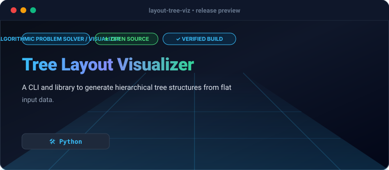

# Tree Layout Visualizer

[](https://github.com/Olamideakinade/layout-tree-viz)
[](https://opensource.org/licenses/MIT)



A tool to transform flat list inputs (parent-child pairs) into hierarchical tree visualizations in the terminal.

## Capabilities
- Converts adjacency list format to visual trees.
- Detects circular dependencies.
- Support for custom depth markers.
- Zero-dependency implementation.

## Quickstart
```bash
pip install .
python main.py --input "A,B;B,C;A,D"
```

## Architecture
- `engine.py`: Handles the recursive tree building and cycle detection.
- `cli.py`: Argument parsing and formatted output stream.
- `tests/`: Unit tests for algorithmic edge cases.

## License
MIT